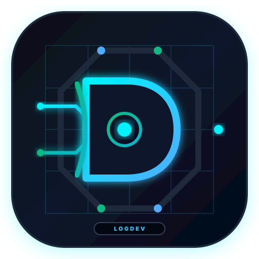

# logdev-Ultimate ⚡

<p align="center">
  
  <br>
  <strong>Simulador de Circuitos Lógicos Digitais & CAD Moderno</strong>
  <br>
  <em>Alta performance em React 18, TypeScript, HTML5 Canvas 2D e Electron</em>
</p>

<p align="center">
  
  
  
</p>

---

## 📖 Visão Geral

O **logdev-Ultimate** é uma recriação moderna, elegante e reativa de ferramentas clássicas de lógica digital (como Logisim Evolution). O sistema combina uma bancada de trabalho redesenhada, temas claro e escuro, canvas gráfico de alto desempenho e motor de simulação discreta de 4 estados elétricos.

Disponível como **aplicação web** e **aplicativo nativo desktop** para **Linux (.rpm)** e **Windows (.exe)**. A versão 1.3.0 reorganiza a interface sem remover as ferramentas existentes, permite alternar entre temas claro e escuro e mantém a inicialização otimizada da versão 1.2.0.

### Versão 1.3.0 — Nova bancada e temas claro/escuro

- **Layout redesenhado:** cabeçalho com contexto do projeto e comandos, biblioteca em painel de catálogo à esquerda, canvas central emoldurado e inspetor contextual à direita.
- **Ferramentas de edição reposicionadas:** Selecionar, Conectar e Interagir ficam em uma barra vertical no canto superior direito do canvas.
- **Tema claro/escuro completo:** alterne pelo botão no cabeçalho; a preferência fica salva para as próximas aberturas. Biblioteca, inspetor, análise, tutorial, menus e canvas acompanham o tema.
- **Canvas adaptável:** fundo e grade ajustam o contraste conforme o tema, preservando as cores que indicam os sinais lógicos.
- **Funções e marca preservadas:** simulação, edição, análise, importação, exportação e demais recursos permanecem disponíveis; a logo não foi alterada.
- **Compatibilidade:** edição web, RPM para Linux x86_64 e instaladores Windows x64.

### Versão 1.2.0 — Interface clean e carregamento otimizado

- **Visual mais clean:** controles e painéis usam uma paleta escura neutra; o logotipo e a marca Ultimate mantêm as cores da identidade visual.
- **Sinais preservados:** cores que distinguem os estados lógicos no canvas continuam funcionando para não comprometer a leitura dos circuitos.
- **Carregamento sob demanda:** exportação PDF/JPEG e a biblioteca jsPDF só são carregadas ao pedir a exportação; JSON continua imediato.
- **Inicialização mais leve:** o bundle principal JavaScript passou de 612,29 kB para 228,01 kB minificado (redução de 62,8%; gzip: de 195,93 kB para 68,49 kB). Os arquivos de exportação e PDF são carregados só quando necessários. O tamanho dos instaladores Electron continua dominado pelo runtime desktop.
- **Posicionamento no cursor:** escolha um item na biblioteca, mova a prévia centralizada sob o cursor e clique para posicionar alinhado à grade; `Escape` cancela.
- **Seleção tipo CAD:** arraste da esquerda para a direita para selecionar elementos totalmente dentro da janela; da direita para a esquerda para selecionar tudo que a janela cruzar. Arraste com o botão do meio, `Alt` ou `Shift` para mover o canvas.
- **Menu de contexto e clipboard:** clique com o botão direito sobre um elemento para recortar, copiar, colar ou excluir; `Ctrl+C`, `Ctrl+X`, `Ctrl+V` e `Delete` também funcionam. Fios entre os componentes copiados acompanham a cópia.
- **Recursos preservados:** rotação, autosave e recuperação, diagnósticos, animação, Undo/Redo, busca, importação e exportação continuam disponíveis.

### Recursos da bancada e do simulador

- **Tutorial de primeiro acesso:** guia em quatro etapas explica montagem, conexões, simulação e exportação; é possível avançar, voltar, pular ou fechar. A conclusão ou o pulo ficam salvos neste navegador e o tutorial automático não aparece novamente.
- **Navegação guiada:** análise, simulação e ações do projeto ficam agrupadas no cabeçalho; as ferramentas de edição ficam na barra do canvas. O canvas vazio também apresenta um passo a passo para montar o primeiro circuito.
- **Análise combinacional:** o botão **Analisar** gera a tabela-verdade, expressões booleanas minimizadas e mapas de Karnaugh a partir dos pinos de entrada, saídas e sondas conectados.
- **Execução isolada:** cada combinação é simulada em uma instância temporária; a análise não altera entradas, estado ou execução do circuito aberto.
- **Limites explícitos:** aceita circuitos de até 200 componentes e 8 entradas conectadas de 1 bit (256 combinações). Os mapas de Karnaugh são exibidos até 4 entradas; tabela e expressões continuam disponíveis até 8.
- **Validação:** circuitos sequenciais, barramentos, saídas indeterminadas, contenções e conexões inválidas são identificados em vez de gerar resultados enganosos.
- **Cronograma de sinais:** monitore até 8 portas conectadas de 1 bit, com até 300 amostras limitadas por histórico. As amostras são coletadas a cada tick e só são gravadas quando há sinais selecionados.
- **Vetores de teste:** configure até 64 linhas com valores esperados em lógica de 4 estados (`0`, `1`, `X`, `Z`); linhas podem formar uma sequência para testar circuitos sequenciais, incluindo clock controlado como entrada. A execução é isolada e preserva o estado original do projeto.
- **Subcircuitos hierárquicos:** selecione componentes conectados e use **Criar subcircuito** no menu de contexto. Entradas e saídas externas são convertidas automaticamente em portas de interface; barramentos preservam sua largura.
- **Edição hierárquica:** dê duplo clique em um bloco reutilizável ou use **Editar subcircuito** no menu de contexto. A navegação mostra o caminho de volta; edições no conteúdo são mantidas no projeto raiz, autosave e exportação JSON.
- **Limite de interface:** portas bidirecionais na fronteira do grupo precisam ser tratadas antes da extração. A importação valida definições aninhadas até 16 níveis.
- **Aritmética, barramentos e seleção:** o somador aceita barramentos de 1 a 32 bits e carry-in/out; o splitter distribui/reúne de 2 a 32 bits; MUX e DEMUX aceitam dados de 1 a 32 bits e podem ser configurados para 2, 4 ou 8 linhas. Decodificador 1:2 até 5:32 e codificador prioritário com 2 a 32 requisições. A seleção multibit usa o bit 0 como menos significativo; o codificador dá prioridade ao índice mais alto.
- **Montagem mais segura:** ao desconectar ou mover portas reconfiguráveis, entradas sem fio voltam a `Z`, estados de pinos seguem o snapshot do projeto e conexões são reposicionadas junto às portas.
- **Junções e ramificações:** clique com o botão direito sobre um fio e escolha **Inserir junção e criar ramificação**. A junção fica exatamente no traçado; clique no ponto da junção e depois em uma porta para desenhar o novo ramo. Fios que apenas se cruzam não se conectam sem uma junção explícita.
- **RAM e ROM configuráveis:** memórias com 1–5 bits de endereço (2–32 posições) e palavras de 1–32 bits. A RAM lê de forma assíncrona e grava na borda de subida do clock com habilitação; a ROM aceita conteúdo binário de 4 estados no inspetor. O estado da RAM é mantido no projeto e recuperado ao reabrir.
- **Sem paridade total ainda:** comparadores, shifters, componentes sequenciais adicionais, importação de projetos Logisim/HDL e integração FPGA continuam em etapas futuras.

---

## 🚀 Principais Recursos

- **Simulação Elétrica Discreta em 4 Estados:**
  - `'0'`: Nível lógico baixo / Terra (0V) — verde escuro.
  - `'1'`: Nível lógico alto / VCC (5V) — verde neon brilhante com efeito glow.
  - `'Z'`: Alta impedância / Desconectado (Tri-State) — ciano flutuante.
  - `'X'`: Contenção / Curto-circuito / Incompatibilidade — vermelho vivo com aviso de erro.
- **Detecção Real de Contenção de Barramento:**
  - Identifica automaticamente se dois drivers ativos emitem sinais divergentes no mesmo condutor ou se há choque de larguras de bits entre portas conectadas, pintando a linha em vermelho sem travar a engine.
- **Roteamento Manhattan Ortogonal Inteligente:**
  - Os fios se alinham automaticamente em ângulos retos de 90° e recalculam seus vértices em tempo real durante o arraste de componentes.
- **Orientação de componentes:** gire componentes em passos de 90° pelo inspetor ou com `R`; portas, hit testing e fios conectados acompanham a rotação.
- **Autosave e recuperação:** projetos são salvos no armazenamento local do navegador/desktop após alterações e recuperados na próxima abertura. O indicador na barra inferior informa o estado do salvamento.
- **Diagnósticos de simulação:** avisos para contenção (`X`), incompatibilidade de largura de barramento e limite de propagação atingido.
- **Animação de sinais ativos:** traços verdes percorrem fios em nível lógico `1` enquanto a simulação está rodando. A animação pausa junto com a simulação; a renderização estática continua disponível.
- **Modo Interativo "Poke" (Mãozinha):**
  - Alterne interruptores, chaves gangorra e pinos de entrada com um clique direto sobre o circuito, observando as ondas de propagação instantaneamente.
- **Análise e verificação:** tabelas-verdade, mapas de Karnaugh, cronograma temporal e vetores de teste para circuitos combinacionais e sequenciais.
- **Exportação Profissional:**
  - **Exportar PDF:** Gera diagramas em folha **A4 branca e monocromática**, ajustados automaticamente a uma única página; a orientação retrato ou paisagem acompanha o formato do circuito.
  - **Exportar JPEG:** Renderiza imagens nítidas em alta resolução (escala 2x DPI) com fundo escuro elegante.
  - **Exportar/Importar JSON:** Salva e restaura o esquema de circuitos na íntegra.
- **Histórico com Undo / Redo:** Desfaça (`Ctrl+Z`) e refaça (`Ctrl+Y`) até 30 alterações de circuito.
- **Circuitos Pré-carregados (Demos):**
  - Somador Completo de 1 bit (*Full Adder*).
  - Latch SR com portas NOR (*Memória Básica com Feedback*).
  - Contador Binário com Clock e Flip-Flops tipo D.

---

## ⚙️ Edição, simulação e salvamento

- Selecione um componente e use **Girar 90°** no inspetor, ou pressione `R`, para rotacioná-lo no sentido horário. O centro do componente é preservado e as conexões são recalculadas.
- Clique em um componente na biblioteca e mova o cursor sobre o canvas para pré-visualizar; clique para posicionar. `Escape` cancela a colocação.
- Arraste sobre uma área vazia do canvas para selecionar uma janela; a direção do arraste define seleção por janela (esquerda→direita) ou cruzada (direita→esquerda). `Ctrl`/`Cmd` adiciona à seleção.
- Clique com o botão direito para abrir as ações de recortar, copiar, colar e excluir; `Ctrl+C`, `Ctrl+X`, `Ctrl+V` e `Delete` são atalhos. Arraste um grupo selecionado para movê-lo em conjunto.
- `Ctrl+Z` desfaz e `Ctrl+Y` refaz; `Ctrl+Shift+Z` também refaz. `Escape` cancela colocação/conexão e limpa a seleção.
- Para criar um bloco reutilizável, selecione componentes com conexões externas e escolha **Criar subcircuito** no menu de contexto. Entre no bloco com duplo clique e use a trilha no topo do canvas para voltar ou navegar aos níveis anteriores.
- Para ramificar um fio, clique nele com o botão direito, insira uma junção e conecte uma porta ao ponto central da junção. Cruzamentos sem junção permanecem eletricamente separados.
- Use **Pausar**, **Avançar 1 Tick** e o seletor de frequência para controlar a simulação. A animação visual dos fios ativos acompanha o estado de execução.
- O autosave local é independente da exportação JSON e não envia projetos à rede. Arquivos inválidos ou armazenamento indisponível são reportados na barra de estado e no console.
- Os avisos de simulação também aparecem no inspetor quando nenhum componente ou fio está selecionado.
- Uma moldura azul/roxa ao redor da página no navegador integrado é um realce da interface de compartilhamento/VS Code, não uma borda desenhada pelo aplicativo.

## 🗂️ Biblioteca de Componentes

| Categoria | Componentes Inclusos |
| :--- | :--- |
| **Fiação & Sinais** | Pinos de Entrada, Pinos de Saída, Clock periódica (1 a 20 Hz), Constantes (0/1), Sondas (*Probes*), Splitter configurável de 2 a 32 bits e junções para ramificar fios. |
| **Portas Lógicas** | AND, OR, NOT, NAND, NOR, XOR, XNOR, Buffer e Tri-State (com suporte a 2 até 8 entradas por porta). |
| **Aritmética** | Somador configurável de barramentos (1 a 32 bits), com carry de entrada e saída; entradas indeterminadas propagam `X`. |
| **Plexers** | Multiplexadores 2:1, 4:1 e 8:1; demultiplexadores 1:2, 1:4 e 1:8; decodificador binário e codificador prioritário. |
| **Memória & Sequencial** | Flip-Flop tipo D (borda de subida de clock) e Registrador multi-bit (com sinal de *Write Enable*). |
| **Entradas e Saídas (I/O)** | Botão pulsador, Chave tipo Toggle, LEDs individuais, Displays de 7 Segmentos e Displays Hexadecimais. |

---

## 🏗️ Arquitetura do Código

A base de código está organizada sob padrões modulares de software:

### Limites entre Electron e interface

- `electron/` é o processo principal do desktop: controla o ciclo de vida da janela e carrega o frontend compilado em `dist/`.
- `src/` é o frontend React/TypeScript. O motor de simulação em `src/engine/` é lógica de domínio executada no renderer; não há um servidor/API backend neste projeto.
- O renderer não recebe acesso direto ao Node.js (`nodeIntegration: false` e `contextIsolation: true`). Como não há comunicação com funcionalidades nativas, não existe uma bridge/preload.
- O empacotamento inclui `dist/`, `electron/` e `build/` (ícones usados pela janela); manter os ícones no pacote é necessário para a inicialização do app desktop.

```text
logdev-studio/
├── build/                      # Ícones da aplicação desktop (.png, .ico)
├── dist/                       # Build estático otimizado gerado pelo Vite
├── electron/
│   └── main.cjs                # Processo principal Electron (ciclo de vida e janela)
├── public/
│   ├── icon.svg                # Favicon vetorial da identidade Nexus
│   └── icon.png                # Ícone PNG usado por integrações web
├── release/                    # Pacotes compilados instaláveis (.rpm, .exe)
├── src/
│   ├── assets/
│   ├── App.tsx                 # Composição da interface React
│   ├── main.tsx                # Entrada do renderer React
│   ├── __tests__/              # Testes de integração de UI e circuitos de demonstração
│   ├── canvas/
│   │   ├── CircuitCanvas.tsx   # Controlador de eventos (pan, zoom, drag, click, poke)
│   │   ├── renderer.ts         # Motor de desenho vetorial no Canvas 2D
│   │   └── wireRouter.ts       # Algoritmo de roteamento Manhattan e teste de colisão
│   ├── components/
│   │   ├── Header.tsx          # Barra de ferramentas superior (controles, clock, exportações)
│   │   ├── LogicAnalyzer.tsx   # Interface de análise e verificação de circuitos
│   │   ├── SignalChronogram.tsx # Captura e visualização temporal de sinais
│   │   ├── Sidebar.tsx         # Catálogo lateral com busca em tempo real
│   │   ├── Inspector.tsx       # Painel de propriedades do elemento selecionado
│   │   ├── TestVectorPanel.tsx # Edição e execução de vetores de teste
│   │   └── StatusBar.tsx       # Informações de ticks, frequência e escala de zoom
│   ├── demos/
│   │   └── sampleCircuits.ts   # Esquemas pré-montados (Full Adder, SR Latch, Contador)
│   ├── engine/
│   │   ├── components.ts       # Metadados de portas, dimensões e simbologia
│   │   ├── componentGeometry.ts # Orientação e geometria de componentes/portas
│   │   ├── logic.ts            # Avaliação de operadores booleanos com dominância
│   │   ├── logicAnalysis.ts    # Tabela-verdade, minimização booleana e mapas de Karnaugh
│   │   ├── simulator.ts        # Simulador de netlist (Union-Find, propagação e contenção)
│   │   └── testVectors.ts      # Execução isolada de sequências de teste
│   ├── hooks/
│   │   └── useCircuitPersistence.ts # Autosave local e recuperação de projetos
│   ├── store/
│   │   └── circuitStore.ts     # Gerenciamento global de estado (Zustand) com Undo/Redo
│   ├── types/
│   │   └── circuit.ts          # Definições de tipos TypeScript (Port, Wire, ComponentInstance)
│   └── utils/
│       ├── circuitPersistence.ts # Validação e serialização do autosave
│       └── exportUtils.ts      # Exportador para PDF (jsPDF) e JPEG em alta definição
├── package.json                # Dependências, scripts e configuração do electron-builder
└── vite.config.ts              # Configurações de empacotamento Vite e testes Vitest
```

---

## 💻 Como Executar Localmente

### Pré-requisitos
- **Node.js** v18 ou superior instalado.
- **npm** v9 ou superior.

### 1. Clonar o repositório
```bash
git clone https://github.com/eduardomelo-dev/logdev-Ultimate.git
cd logdev-studio
```

### 2. Instalar dependências
```bash
npm install
```

### 3. Iniciar em modo de desenvolvimento web
```bash
npm run dev
```
O simulador abrirá em seu navegador em `http://localhost:5173`.

### 4. Executar os testes automatizados
```bash
npm test
```
Executa a suíte de testes unitários e de integração via Vitest.

---

## 📦 Como Gerar os Aplicativos Desktop

O projeto está configurado com **Electron** e **Electron Builder**:

### Executar a aplicação desktop em modo janela
```bash
npm run electron:start
```

### Gerar pacote para Linux (.rpm)
```bash
npm run dist:linux
```
> Gera `release/logdev-ultimate-1.3.0.x86_64.rpm`.

Para instalar no Fedora/RHEL:
```bash
sudo dnf install release/logdev-ultimate-1.3.0.x86_64.rpm
```

### Gerar instalador e executável para Windows (.exe)
```bash
npm run dist:win
```
> Gera dois arquivos em `release/`:
> 1. `release/logdev-Ultimate Setup 1.3.0.exe` (Instalador com assistente)
> 2. `release/logdev-Ultimate 1.3.0.exe` (Versão portátil sem instalação)

---

## 📥 Downloads Oficiais (Release v1.3.0)

Os arquivos desta versão ficam disponíveis na página da release. As versões v1.0.0, v1.1.0 e v1.2.0 permanecem disponíveis e inalteradas.

| Sistema | Arquivo | Tamanho | Como Instalar |
|---------|---------|---------|---------------|
| **Linux (Fedora/RHEL)** | [`logdev-ultimate-1.3.0.x86_64.rpm`](https://github.com/eduardomelo-dev/logdev-Ultimate/releases/download/v1.3.0/logdev-ultimate-1.3.0.x86_64.rpm) | RPM x86_64 | `sudo dnf install logdev-ultimate-1.3.0.x86_64.rpm` |
| **Windows (Portable)** | [`logdev-Ultimate.1.3.0.exe`](https://github.com/eduardomelo-dev/logdev-Ultimate/releases/download/v1.3.0/logdev-Ultimate.1.3.0.exe) | x64 | Clique duas vezes — executa sem instalação |
| **Windows (Instalador)** | [`logdev-Ultimate.Setup.1.3.0.exe`](https://github.com/eduardomelo-dev/logdev-Ultimate/releases/download/v1.3.0/logdev-Ultimate.Setup.1.3.0.exe) | x64 | Clique duas vezes e siga o assistente |

> 📌 **Release page:** https://github.com/eduardomelo-dev/logdev-Ultimate/releases/tag/v1.3.0

## 📥 Downloads anteriores

| Sistema | Release v1.1.0 | Tamanho |
|---------|----------------|---------|
| **Linux (Fedora/RHEL)** | [RPM x86_64](https://github.com/eduardomelo-dev/logdev-Ultimate/releases/download/v1.1.0/logdev-ultimate-1.1.0.x86_64.rpm) | 91 MB |
| **Windows (Portable)** | [Executável portátil](https://github.com/eduardomelo-dev/logdev-Ultimate/releases/download/v1.1.0/logdev-Ultimate.1.1.0.exe) | 110 MB |
| **Windows (Instalador)** | [Instalador NSIS](https://github.com/eduardomelo-dev/logdev-Ultimate/releases/download/v1.1.0/logdev-Ultimate.Setup.1.1.0.exe) | 124 MB |

---

## 📥 Downloads Oficiais (Release v1.0.0)

| Sistema | Arquivo | Tamanho | Como Instalar |
|---------|---------|---------|---------------|
| **Linux (Fedora/RHEL)** | [`logdev-ultimate-1.0.0.x86_64.rpm`](https://github.com/eduardomelo-dev/logdev-Ultimate/releases/download/v1.0.0/logdev-ultimate-1.0.0.x86_64.rpm) | 91 MB | `sudo dnf install logdev-ultimate-1.0.0.x86_64.rpm` |
| **Windows (Portable)** | [`logdev-Ultimate.1.0.0.exe`](https://github.com/eduardomelo-dev/logdev-Ultimate/releases/download/v1.0.0/logdev-Ultimate.1.0.0.exe) | 109 MB | Clique duas vezes — executa sem instalação |
| **Windows (Instalador)** | [`logdev-Ultimate.Setup.1.0.0.exe`](https://github.com/eduardomelo-dev/logdev-Ultimate/releases/download/v1.0.0/logdev-Ultimate.Setup.1.0.0.exe) | 124 MB | Clique duas vezes e siga o assistente |

> 📌 **Release page:** https://github.com/eduardomelo-dev/logdev-Ultimate/releases/tag/v1.0.0

---

## 📄 Licença

Distribuído sob a licença MIT. Veja `LICENSE` para mais detalhes.

Desenvolvido com excelência por **Eduardo Melo**.
